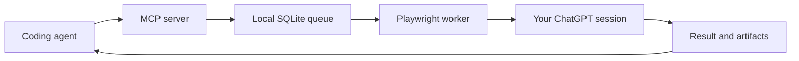

# ChatGPT Wrapper

**I ran out of Codex usage, so I literally wrapped ChatGPT.**

Connect your own ChatGPT browser session to coding agents using **MCP**. Wrapper runs locally, sends tasks through a real Chromium browser, and returns text, code, and image artifacts to your client.

**[Watch the 40-second demo](docs/assets/wrapper-demo.mp4)** · **[Install](#quick-start)** · [npm](https://www.npmjs.com/package/@rnaefe/chatgpt-wrapper) · [Documentation](#documentation)

[](docs/assets/wrapper-demo.mp4)

_The demo is an edited product presentation using captured results; it isn't an uncut recording. No API key is required, but you must sign in with your own ChatGPT account._

## Quick start

**Requirements:** Node.js 24+, npm, a desktop environment, and a ChatGPT account. The full setup and live coding workflow have been verified on **macOS**; Windows and Linux still need broader testing.

**1. Install and connect to Codex**

```bash
npx -y @rnaefe/chatgpt-wrapper@0.6.0
```

The installer downloads Chromium, configures the Wrapper MCP server in Codex, and backs up any existing configuration before making changes. No clone or manual MCP config editing needed.

**2. Sign in once**

Complete the ChatGPT sign-in in the browser window. Wrapper keeps the session in a separate local profile. Browser verification, if requested, must be completed manually.

**3. Restart Codex and try a task**

> Use the Wrapper MCP server to generate a TypeScript LRU cache with a short usage example. Check the task until it completes, then show me the result.

Your coding agent sends the task via MCP; Wrapper returns the result for review. It does **not** run generated code or change your project files.

**Using a different client?**

```bash
npx -y @rnaefe/chatgpt-wrapper@0.6.0 setup --client cursor
npx -y @rnaefe/chatgpt-wrapper@0.6.0 setup --client claude-desktop
```

These commands configure the selected MCP client; support for its configuration format doesn't imply every OS and browser combination has been tested. See [installation and custom paths](docs/INSTALLATION.md).

## What it does

- **MCP interface:** submit coding or analysis tasks, inspect their status, cancel work, and retrieve results.
- **Durable task queue:** SQLite stores tasks and artifacts; interrupted browser work isn't silently submitted twice.
- **Browser session management:** Playwright opens your saved ChatGPT session for work and closes the window afterward.
- **Developer tooling:** a CLI for setup, reconnecting, updates and uninstall, plus local task diagnostics.



Wrapper is a **task bridge**, not another autonomous coding agent. Your MCP client handles planning, source files, applying changes, and reviewing generated output.

Version **0.6.0** includes code generation, code review, reasoning, image generation, image analysis and image editing, plus `wait_task`, `get_status` and chat-ready image exports. Image analysis and editing require input images; live provider access remains dependent on the account and browser UI. See [MCP usage](docs/MCP.md) for task schemas and [releases](https://github.com/rnaefe/chatgpt-wrapper/releases) for shipped versions.

## Useful commands

**Version 0.6.0 also includes:** selected code/PDF/DOCX attachments, durable task batches, Search research with source links, model selection, conversation continuation and terminal progress watching. See [MCP feature usage](docs/MCP.md#attach-selected-files).

```bash
# Check your installation without starting a browser
npx -y @rnaefe/chatgpt-wrapper@latest doctor

# Reconnect your saved session if login is needed
npx -y @rnaefe/chatgpt-wrapper@latest connect

# Upgrade a managed installation
npx -y @rnaefe/chatgpt-wrapper@latest update

# Remove Wrapper from the selected MCP client's config
npx -y @rnaefe/chatgpt-wrapper@latest uninstall
```

Uninstall preserves your local profile and task data so other installed clients are not unexpectedly broken. To remove your data, follow the [complete removal instructions](docs/INSTALLATION.md#updating-and-removing).

## Good to know

| Question                                           | Answer                                                                                                                         |
| -------------------------------------------------- | ------------------------------------------------------------------------------------------------------------------------------ |
| **Is this an official OpenAI integration?**        | No. This is an independent experimental project that automates the ChatGPT web interface, not an official API.                 |
| **Does it bypass account limits or verification?** | No. Your normal account limits apply; login and browser challenges require you.                                                |
| **Will it work headlessly?**                       | Headless mode is experimental and has encountered browser verification. Visible mode is the default.                           |
| **Is it reliable on Windows/Linux?**               | Client configuration is supported in documented environments, but equivalent live end-to-end acceptance hasn't been completed. |
| **Where is my data?**                              | Your profile, task history and local diagnostics stay on your machine. Task prompts and uploaded content are sent to ChatGPT.  |
| **Will it edit my repository?**                    | No. It returns results to the MCP client, which decides what to do with them.                                                  |

**Security:** Treat the saved browser profile and local tokens as credentials. Do not publish them, and only submit data you are authorized to share. Review the provider's applicable terms. [Security and privacy](docs/SECURITY.md) · [Known browser limitations](docs/BROWSER_RELIABILITY.md).

## Documentation

- [Install, configure, update or uninstall](docs/INSTALLATION.md)
- [Use the MCP tools](docs/MCP.md)
- [Troubleshoot authentication and browser tasks](docs/TROUBLESHOOTING.md)
- [Architecture and design decisions](docs/ARCHITECTURE.md)
- [Contributing](CONTRIBUTING.md)

## Contributing

Issues, bug reports and small pull requests are welcome. If a provider UI change breaks a task, please share a minimal reproduction **without** private prompts, screenshots of your account, browser profiles or credentials.

[Open an issue](https://github.com/rnaefe/chatgpt-wrapper/issues/new/choose) · [Contribute](CONTRIBUTING.md) · [Report a security issue privately](https://github.com/rnaefe/chatgpt-wrapper/security/advisories/new)

Licensed under **[GPL-3.0](LICENSE)**.
