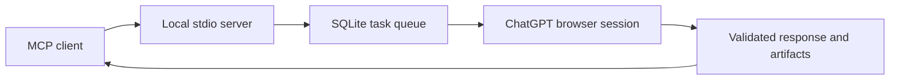

# ChatGPT Wrapper

**I ran out of Codex usage, so I literally wrapped ChatGPT.**

A local MCP server that connects coding agents to your own ChatGPT browser session. It queues tasks, uses Playwright to run them in the browser, and sends code, analysis, and artifacts back to your MCP client.

[](docs/assets/wrapper-demo.mp4)

**[Watch the full 40-second demo](docs/assets/wrapper-demo.mp4)** · [Install guide](docs/INSTALLATION.md) · [npm package](https://www.npmjs.com/package/@rnaefe/chatgpt-wrapper) · [How it works](#how-it-works) · [Source of the demo](video/README.md)

The video is an edited product presentation using real captured outputs, not an uncut browser recording. [What's real, what's illustrated](video/README.md#evidence-behind-the-film).

## Try it

**Node.js 24+ · npm · a desktop browser session.** The released installer targets Codex by default.

```bash
npx -y @rnaefe/chatgpt-wrapper@0.4.2
```

1. The CLI installs Chromium and configures Codex, backing up existing configuration.
2. Sign in to ChatGPT manually in the browser window. Your session stays in a separate, private profile.
3. Restart Codex and ask it to use Wrapper for a task:

> Use Wrapper to generate a TypeScript LRU cache with a usage example. Wait for the task to complete, then show the result.

The browser opens for tasks and closes afterward. Wrapper returns generated results for review; it **doesn't run generated code or modify your repository**.

Using Cursor or Claude Desktop? See [client setup options](docs/INSTALLATION.md#client-configuration).

**Unofficial and experimental.** Uses your own ChatGPT account, not the OpenAI API. Browser verification, UI changes and provider account limits may interrupt tasks. No verification bypass or automatic prompt replay; review your provider's terms before use.

## Everyday commands

```sh
# Update the managed installation, then restart your MCP client
npx -y @rnaefe/chatgpt-wrapper@latest update

# Reconnect if ChatGPT asks you to sign in again
npx -y @rnaefe/chatgpt-wrapper@latest connect

# Inspect the installation without opening a browser
npx -y @rnaefe/chatgpt-wrapper@latest doctor

# Remove Wrapper from Codex, preserving saved data
npx -y @rnaefe/chatgpt-wrapper@latest uninstall
```

Update and uninstall recognize managed settings from the selected client. Other client entries are preserved. User profiles, history and logs remain on disk after uninstall; [removal details](docs/INSTALLATION.md#updating-and-removing) explain how to erase them deliberately.

## How it works



One worker processes one task at a time. Clients share the authenticated loopback worker and queue. Tasks persist across restarts, but interrupted submissions are never replayed automatically.

| MCP tool       | Purpose                                        |
| -------------- | ---------------------------------------------- |
| `submit_task`  | Queue a coding, review, analysis or image task |
| `get_task`     | Read status, response and event history        |
| `wait_task`    | Await completion for up to 30 seconds          |
| `get_status`   | Inspect readiness, capabilities and queue      |
| `list_tasks`   | Browse tasks, with optional status filtering   |
| `cancel_task`  | Cancel queued or running work                  |
| `get_artifact` | Read a stored text or image result             |
| `get_metrics`  | Inspect success rates and task durations       |
| `list_errors`  | Inspect recent task IDs and error codes        |

The development source supports code generation, review, reasoning, image generation, image analysis and image editing. Analysis and editing require input images. Newer development features are not necessarily available in the published v0.4.2 npm package.

See the [MCP usage guide](docs/MCP.md) for request examples and status handling. Local queue measurements and their limits are documented in [performance](docs/PERFORMANCE.md).

## Development source capabilities

The repository's working source adds image analysis/editing, long-poll task waiting, chat-ready image exports and task-specific prompt contracts beyond the published v0.4.2 release. Prompts preserve objectives and constraints in JSON, request the appropriate deliverable for each capability, and distinguish evidence from assumptions. Prompt wording is not a security boundary or a substitute for reviewing results.

## What is verified

The published v0.4.2 package was checked with a clean npm installation, Codex config preservation, a seven-tool MCP handshake, and update/uninstall tests. Live visible coding tasks completed through MCP on macOS. These individual tests aren't an uptime guarantee.

**Visible mode is the default.** Experimental headless mode encountered ChatGPT browser verification in the recorded test. Initial sign-in and verification remain manual. There is no challenge bypass or automatic prompt retry. Windows/Linux acceptance and long-session reliability remain unverified; image tasks were not part of the live coding checks. See [browser reliability](docs/BROWSER_RELIABILITY.md) for the evidence and repeatable checks.

## Data and configuration

No `.env` is needed for installation. Packaged installs use the OS application-data directory; repository development uses `.data`. The separate `playwright-profile` contains the saved ChatGPT session. Never share it, bearer tokens or task databases.

Terminal tasks and unreferenced artifacts expire after 30 days by default (`TASK_RETENTION_DAYS=0` disables expiry). Browser credentials and logs are retained until removed. Image file paths and HTTPS downloads require explicit allowlists. Prompts and results are sent to ChatGPT; metrics stay local.

Read [security and privacy](docs/SECURITY.md), [configuration](docs/INSTALLATION.md) and [observability](docs/OBSERVABILITY.md).

## Contribute

```sh
pnpm install --frozen-lockfile
pnpm browser:install
pnpm check
```

Tests use local fixtures and do not require a ChatGPT account. Real provider checks are separate and explicitly invoked. See [CONTRIBUTING.md](CONTRIBUTING.md) for the package map, focused test commands and release checks. No CI workflow is included.

[Report a bug](https://github.com/rnaefe/chatgpt-wrapper/issues/new/choose) · [Report a vulnerability privately](https://github.com/rnaefe/chatgpt-wrapper/security/advisories/new) · [Roadmap](docs/ROADMAP.md)

Licensed under [GNU GPL v3](LICENSE).
