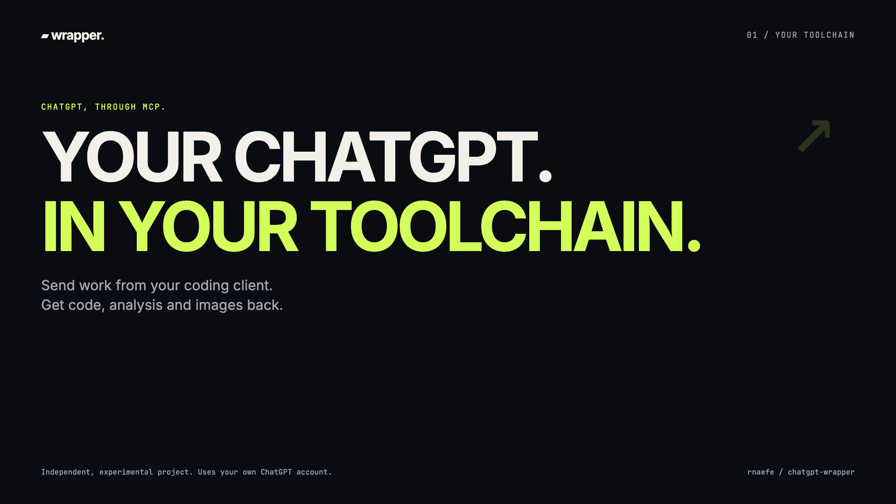
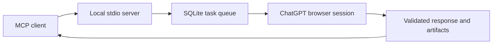

# ChatGPT Wrapper

Use your ChatGPT browser session from an MCP coding client. Wrapper queues a task, runs it in ChatGPT, and returns the response with code blocks intact.

[Install](docs/INSTALLATION.md) · [npm](https://www.npmjs.com/package/@rnaefe/chatgpt-wrapper) · [Releases](https://github.com/rnaefe/chatgpt-wrapper/releases) · [Contribute](CONTRIBUTING.md)

[](docs/assets/wrapper-demo.mp4)

**[Watch the 40-second demo with music](docs/assets/wrapper-demo.mp4)** · [Captions](docs/assets/captions.vtt) · [Video source](video/README.md)

A 1080p product film with an original electronic score, actual captured code output, a Wrapper-generated image and a local queue benchmark. Designed scenes show the development workflow; this is an edited presentation, not an uncut screen recording. [Evidence and rendering details](video/README.md).

<details>
<summary>Play the animated preview</summary>


</details>

An unofficial, experimental project. Requires your own ChatGPT account; no OpenAI API key. Provider UI changes, verification prompts and account limits can interrupt tasks.

## Start with Codex

Requires **Node.js 24+**, npm and a desktop session.

```sh
npx -y @rnaefe/chatgpt-wrapper@0.4.2
```

1. Setup installs Chromium and adds Wrapper to your Codex configuration, with a backup.
2. Sign in to ChatGPT in the window that opens. Wrapper detects the session and closes the window.
3. Restart Codex, then ask it to use Wrapper for a task.

For example:

> Use Wrapper to generate a TypeScript LRU cache with a usage example. Use wait_task until it finishes, then show me the result.

The browser opens while each task runs and closes afterwards. Your saved session is reused. Generated code is returned for review; Wrapper does not execute commands or modify your repository.

For another client, run `setup --client cursor` or `setup --client claude-desktop`. For custom paths, existing installations and removal, see the [installation guide](docs/INSTALLATION.md).

## Everyday commands

```sh
# Update the managed installation, then restart your MCP client
npx -y @rnaefe/chatgpt-wrapper@latest update

# Reconnect if ChatGPT asks you to sign in again
npx -y @rnaefe/chatgpt-wrapper@latest connect

# Inspect the installation without opening a browser
npx -y @rnaefe/chatgpt-wrapper@latest doctor

# Remove Wrapper from Codex, preserving saved data
npx -y @rnaefe/chatgpt-wrapper@latest uninstall
```

Update and uninstall recognize managed settings from the selected client. Other client entries are preserved. User profiles, history and logs remain on disk after uninstall; [removal details](docs/INSTALLATION.md#updating-and-removing) explain how to erase them deliberately.

## How it works



One worker processes one task at a time. Clients share the authenticated loopback worker and queue. Tasks persist across restarts, but interrupted submissions are never replayed automatically.

| MCP tool       | Purpose                                        |
| -------------- | ---------------------------------------------- |
| `submit_task`  | Queue a coding, review, analysis or image task |
| `get_task`     | Read status, response and event history        |
| `wait_task`    | Await completion for up to 30 seconds          |
| `get_status`   | Inspect readiness, capabilities and queue      |
| `list_tasks`   | Browse tasks, with optional status filtering   |
| `cancel_task`  | Cancel queued or running work                  |
| `get_artifact` | Read a stored text or image result             |
| `get_metrics`  | Inspect success rates and task durations       |
| `list_errors`  | Inspect recent task IDs and error codes        |

Tasks support code generation, code review, reasoning, image generation, image analysis and image editing. Analysis and editing require input images. Image results include local files and Markdown links for chat delivery.

See the [MCP usage guide](docs/MCP.md) for request examples and status handling. Local queue measurements and their limits are documented in [performance](docs/PERFORMANCE.md).

## Development improvements

The working source adds image analysis/editing, long-poll task waiting, chat-ready image exports and task-specific prompt contracts. Prompts preserve objectives and constraints in JSON, request the appropriate deliverable for each capability, and distinguish evidence from assumptions. Prompt wording is not a security boundary or a substitute for reviewing results.

## What is verified

On macOS, the 0.4.2 release passed 76 tests, a clean npm installation, Codex config preservation, a seven-tool MCP handshake, update and uninstall checks. Two live visible coding probes completed in 10.0 and 11.0 seconds. These are individual test results, not an uptime guarantee.

**Visible mode is the default.** Experimental headless mode encountered ChatGPT browser verification in the recorded test. Initial sign-in and verification remain manual. There is no challenge bypass or automatic prompt retry. Windows/Linux acceptance and long-session reliability remain unverified; image tasks were not part of the live coding checks. See [browser reliability](docs/BROWSER_RELIABILITY.md) for the evidence and repeatable checks.

## Data and configuration

No `.env` is needed for installation. Packaged installs use the OS application-data directory; repository development uses `.data`. The separate `playwright-profile` contains the saved ChatGPT session. Never share it, bearer tokens or task databases.

Terminal tasks and unreferenced artifacts expire after 30 days by default (`TASK_RETENTION_DAYS=0` disables expiry). Browser credentials and logs are retained until removed. Image file paths and HTTPS downloads require explicit allowlists. Prompts and results are sent to ChatGPT; metrics stay local.

Read [security and privacy](docs/SECURITY.md), [configuration](docs/INSTALLATION.md) and [observability](docs/OBSERVABILITY.md).

## Contribute

```sh
pnpm install --frozen-lockfile
pnpm browser:install
pnpm check
```

Tests use local fixtures and do not require a ChatGPT account. Real provider checks are separate and explicitly invoked. See [CONTRIBUTING.md](CONTRIBUTING.md) for the package map, focused test commands and release checks. No CI workflow is included.

[Report a bug](https://github.com/rnaefe/chatgpt-wrapper/issues/new/choose) · [Report a vulnerability privately](https://github.com/rnaefe/chatgpt-wrapper/security/advisories/new) · [Roadmap](docs/ROADMAP.md)

Licensed under [GNU GPL v3](LICENSE).
